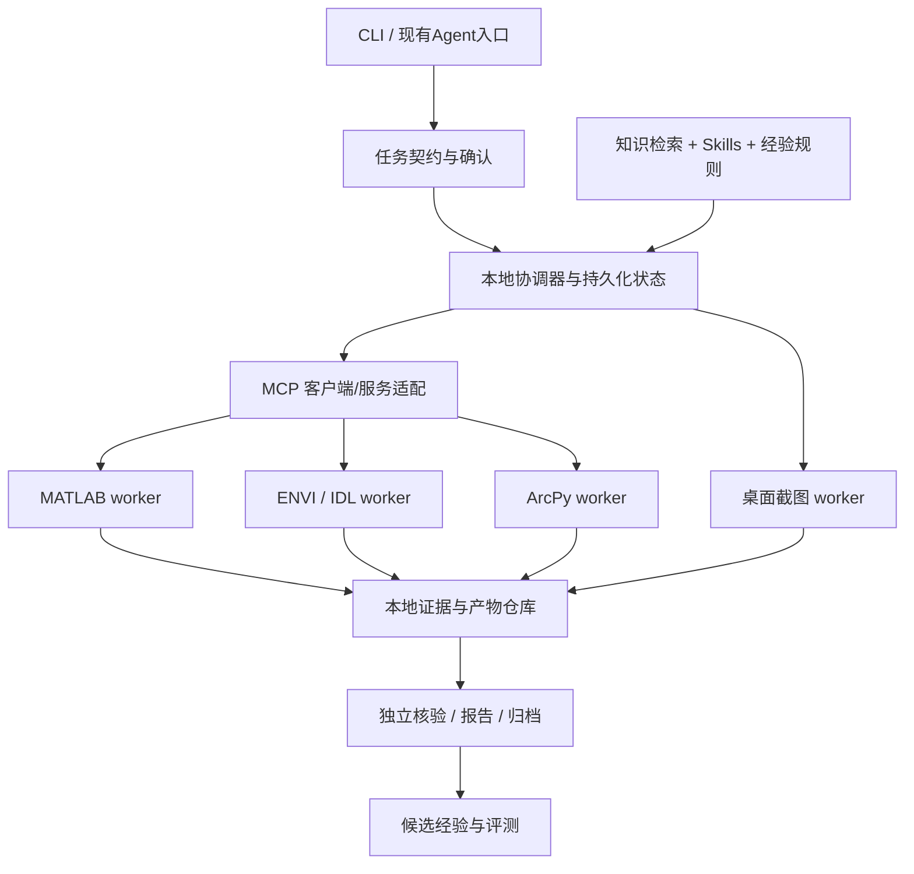

Here is the result of "fetch" for the Page with URL https://app.notion.com/p/3fec5fcc8d9381f59a97e0332dae55c3 as of 2026-10-19T12:25:37.454Z:
<page url="https://app.notion.com/p/3fec5fcc8d9381f59a97e0332dae55c3" icon="⚙️">
<ancestor-path>
<parent-page url="https://app.notion.com/p/3fec5fcc8d9381dea5f1f4764286ce47" title="AI 遥感本地 Agent｜三成员协作与Notion任务计划 v1.1"/>
</ancestor-path>
<properties>
{"title":"01｜系统架构、软件接入与开源资源复用"}
</properties>
<iconMetadata>{"type":"emoji","emoji":"⚙️"}</iconMetadata>
<content>
本文是实施设计。工具名、目录和命令是拟定契约，尚未实现；以T03冻结的实际接口版本为准。
# 1. 运行架构与技术选择

- CLI/模型编排进程使用独立Python环境；通过子进程协议调用软件worker。ArcPy保留Pro专用环境，ENVI与MATLAB接口按各自版本匹配，不强求一个Python环境安装全部软件依赖。
- 本地协调器保有真实任务状态；DeepSeek/GPT通过API提供规划与工具选择。云端模型不直接承担遥感数值计算。
- 首版单机串行执行软件任务。确认许可、内存、进程隔离后，才增加独立任务并发；桌面交互始终串行。
- 云端Codex是开发角色，不是实验云算力。允许查技术资料，不以云端执行结果替代用户本机验收。
- 单图常规方法先走成熟封装。任意脚本探索使用独立试验目录、明确目的与预算，验证后才能纳入正式工作流。
# 2. 软件接入策略
<table fit-page-width="true" header-row="true">
<tr>
<td>软件</td>
<td>首选通道</td>
<td>首个能力验收</td>
<td>限制与回退</td>
</tr>
<tr>
<td>MATLAB</td>
<td>MathWorks官方MCP + 相关Agentic Toolkit Skills；专用方法封装</td>
<td>枚举版本/工具箱→读取用户数据子集→固定脚本→保存结果→重读核验→真实窗口截图</td>
<td>本机许可与版本待查；Engine API/批处理作替代通道，避免重复开发全部通用功能</td>
</tr>
<tr>
<td>ENVI</td>
<td>本机Task Engine / envipyengine，外加自有MCP适配</td>
<td>枚举任务和参数→一个真实原生处理→保存栅格与头文件→重读→显示结果截图</td>
<td>ENVI Classic与现代接口分别登记；新版文档不代表5.6可用；缺少接口的明确步骤才采用GUI</td>
</tr>
<tr>
<td>ArcGIS Pro</td>
<td>独立ArcPy worker，使用Pro配套Python/propy</td>
<td>环境及扩展检查→一个本地栅格操作→创建/保存aprx→重开无坏链→软件截图</td>
<td>许可类型、Spatial/Image Analyst等扩展按任务检查；应用外activeView/activeMap不可依赖</td>
</tr>
<tr>
<td>桌面交互</td>
<td>pywinauto/UIA等已验证控件流程</td>
<td>识别进程窗口→验证文件身份→等待渲染→截图→绑定步骤证据</td>
<td>需要可用交互会话；锁屏、RDP断开等导致失败时保留任务等待，不伪造截图</td>
</tr>
<tr>
<td>独立检查</td>
<td>Python/GDAL/rasterio等按需安装</td>
<td>重读文件、维度/CRS/NoData/计数/指标/矢量检查</td>
<td>独立检查不等于用近似算法替代软件原生结果</td>
</tr>
</table>
# 3. 工具契约
拟定工具：environment.inspect、software.capabilities、dataset.inspect、samples.validate、workflow.validate、workflow.submit、run.status、run.cancel、artifacts.list、evidence.capture、outputs.verify、[report.build](http://report.build)。
- 查询工具可直接运行；产生新实验结果的工具必须带已确认的plan_revision与approval_id。下层执行器校验契约，不能只依赖模型记住规则。
- 长任务提交后返回job_id；status返回运行、完成、失败、取消和日志位置；不把整个计算绑在一次模型调用连接上。
- 工具参数包含project_id、run_id、step_id、dataset_id、工具/方法版本、参数、输入指纹、输出目录、超时、幂等键。数据路径由已登记的数据标识解析。
- outputs返回结构化元数据与文件标识，不把大栅格塞进模型上下文；缩略图和统计摘要按任务需要生成。
- 成功返回需要产物检查通过。可空产物、警告和部分失败必须显式表述。
```json
{
  "run_id": "RUN-...",
  "step_id": "STEP-...",
  "job_id": "JOB-...",
  "plan_revision": 1,
  "status": "succeeded",
  "software": {"name": "ENVI", "version": "detected"},
  "method_version": "pinned-version",
  "effective_parameters": {},
  "input_manifest_hash": "...",
  "outputs": [{"artifact_id": "ART-...", "relative_path": "...", "sha256": "..."}],
  "log_artifact_id": "ART-...",
  "screenshot_ids": ["EVD-..."],
  "checks": [{"check_id": "CHK-...", "passed": true}],
  "warnings": []
}
```
上述示例仅描述结构，不代表已有成功运行。
# 4. 数据、坐标与跨软件约定
- dataset记录文件对/辅助文件、行列波段、dtype、交错格式、字节序、NoData、CRS、仿射变换、像元尺寸、单位、波段语义、比例因子及来源；未知值保留未知。
- 类别同时记录native_code与semantic_id；训练标签、输出栅格、图例、统计表共用一版映射。未分类与其他类分别处理。
- 标签重采样默认最近邻，连续变量方法由任务指定；所有重投影记录目标网格、像元对齐与NoData处理。
- 用户提供影像无CRS时保持像素坐标与像元计数；地图展示和面积换算不自动补充虚构坐标。
- 只在必要边界转换文件格式。交换格式选GeoTIFF/ENVI栅格+HDR/CSV/GeoPackage等，按双方实际支持能力决定；保留原生文件及转换记录。
- 大影像先做预检与用户数据子集试运行，再分块或批处理；检查磁盘/内存估算和临时文件回收条件。首版不承诺任意规模。
# 5. 模型接入
- provider配置保存API地址、模型标识、超时、工具调用能力、上下文和视觉支持能力；运行时探测/配置而非以“GPT/DeepSeek”名称猜功能。
- 统一工具schema并检测参数返回；不支持原生工具调用的模型需明确适配验证，不能静默接受无法解析的文本命令。
- 图像理解使用经验证的视觉模型；不可用时依赖数值检查并要求必要的人审，不把纯文本模型当作已看图。
- 每次任务记录实际模型、用量、重试、耗时、费用估算来源。默认一个主模型，规划失败或高价值复核才切换模型；不强制多模型反复讨论。
- 切换模型时传结构化任务状态与证据引用，不重放全部对话、不重算已完成步骤。
# 6. 官方资源与GitHub复用候选
以下链接已经进行文档/README层面的调研；均未完成用户Windows现场验证。引入时记录固定tag/commit、许可证、依赖、适配结果和回退方式。
<table fit-page-width="true" header-row="true">
<tr>
<td>资源</td>
<td>用途与采用建议</td>
<td>验收注意</td>
</tr>
<tr>
<td>[MathWorks MATLAB MCP Server](https://github.com/matlab/matlab-mcp-server)</td>
<td>官方；优先复用会话、执行、检查与环境能力</td>
<td>调研时README列R2021a+；连接既有会话另有版本条件。Windows Codex配置关注WINDIR；精确条件引入时重新核实</td>
</tr>
<tr>
<td>[MATLAB Agentic Toolkit](https://github.com/matlab/matlab-agentic-toolkit)</td>
<td>官方；选取MATLAB编程、调试、图像处理相关Skills</td>
<td>只载入相关技能，补充本项目遥感方法与验收；通用技能不等于遥感任务已验证</td>
</tr>
<tr>
<td>[MATLAB Engine API](https://www.mathworks.com/help/matlab/matlab_external/install-the-matlab-engine-for-python.html)</td>
<td>官方；专用Python封装或替代通道</td>
<td>按MATLAB发行版匹配Python与Engine，不直接安装最新版</td>
</tr>
<tr>
<td>[ENVI Py Engine文档](https://www.nv5geospatialsoftware.com/docs/ENVIPyEngine.html) 与 [源码](https://github.com/envi-idl/envipyengine)</td>
<td>官方；任务发现、参数查询与执行；源码MIT</td>
<td>当前文档与历史安装版本可能不同；ENVI/IDL及扩展许可另查</td>
</tr>
<tr>
<td>[IDL Task Engine](https://www.nv5geospatialsoftware.com/docs/RunIDLAnalyticsCommandLine.html)</td>
<td>官方；taskengine进程、JSON标准流与工作目录</td>
<td>验证退出码、stderr、许可等待、超时和取消，不能只看进程启动成功</td>
</tr>
<tr>
<td>[ArcGIS Pro Python](https://doc.esri.com/en/arcgis-pro/latest/arcpy/get-started/installing-python-for-arcgis-pro.html) 与 [扩展许可](https://doc.esri.com/en/arcgis-pro/latest/arcpy/geoprocessing_and_python/accessing-licenses-and-extensions-in-python.html)</td>
<td>官方；ArcPy worker与环境预检</td>
<td>保留Pro环境；按工具检查实际所需许可</td>
</tr>
<tr>
<td>[ArcGISProject](https://doc.esri.com/en/arcgis-pro/latest/arcpy/mapping/arcgisproject-class.html)</td>
<td>官方；工程、图层、数据源与保存</td>
<td>应用外activeMap/activeView返回None；项目保存和真实窗口截图分别验收</td>
</tr>
<tr>
<td>[Knight60/ArcGIS-Pro-MCP](https://github.com/Knight60/ArcGIS-Pro-MCP)</td>
<td>社区；Add-in/现场控制备选，非首版基础依赖</td>
<td>调研时README要求Pro 3.7，AGPL-3.0并附商业许可说明；兼容性和复用方式需审查</td>
</tr>
<tr>
<td>[MCP Python SDK](https://github.com/modelcontextprotocol/python-sdk)</td>
<td>官方；服务与客户端工具协议</td>
<td>固定SDK发行版及文档；独立运行环境，不照搬不同主版本教程</td>
</tr>
<tr>
<td>[pywinauto](https://github.com/pywinauto/pywinauto) 与 [桌面限制](https://pywinauto.readthedocs.io/en/latest/remote_execution.html)</td>
<td>社区；已验证软件窗口操作与截图</td>
<td>锁屏/RDP/服务会话限制；先验证控件可访问性，再决定GUI覆盖范围</td>
</tr>
</table>
# 7. 自研与复用边界
优先复用：官方软件执行接口、MATLAB官方MCP与相关Skills、MCP SDK、文档解析与栅格读写库。
需要自研：遥感任务契约、方法参数约束、ENVI/ArcPy受控封装、统一证据结构、步骤截图关联、结果核验规则、经验晋级和任务恢复。
暂不建设：自己的桌面GUI、遥感影像搜索下载、多人SaaS、分布式计算集群、模型微调平台。
# 8. 连接能力清单的必填项
软件/版本/安装路径、worker环境、许可类别与扩展、API或GUI通道、已验证任务、输入格式、参数schema、已知失败、测试案例、截图能力、最后验证时间、适配器commit。状态为未探测/可用/受限/不可用；禁止把“软件已安装”当成全部工具可用。
</content>
</page>
